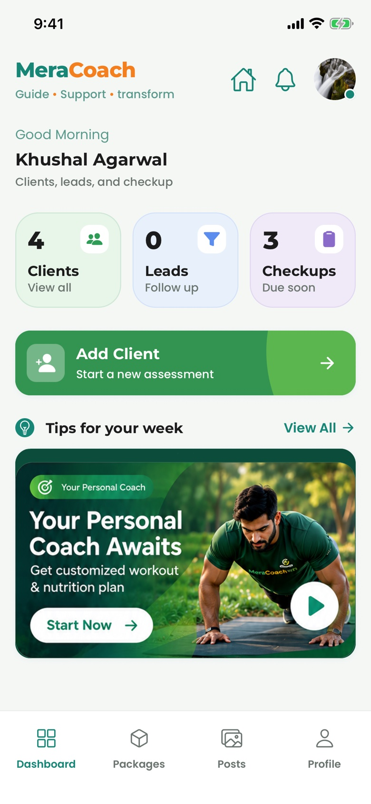
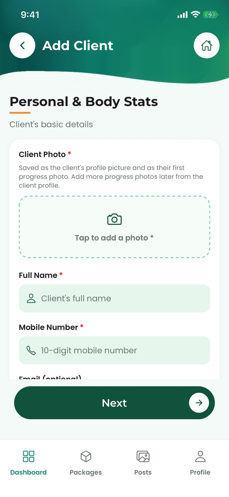
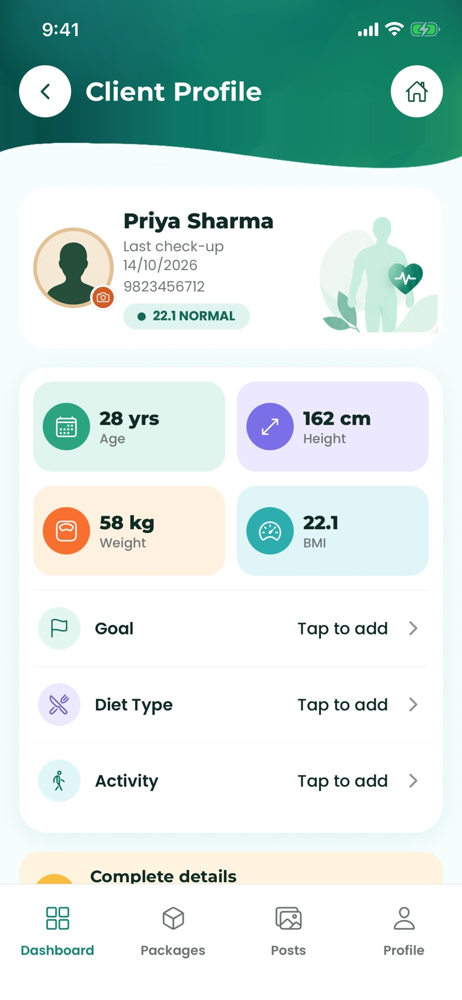
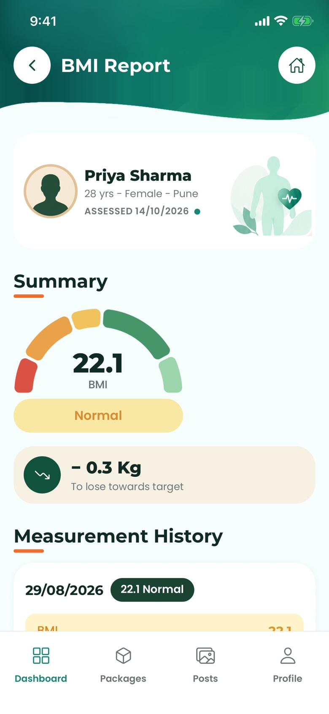
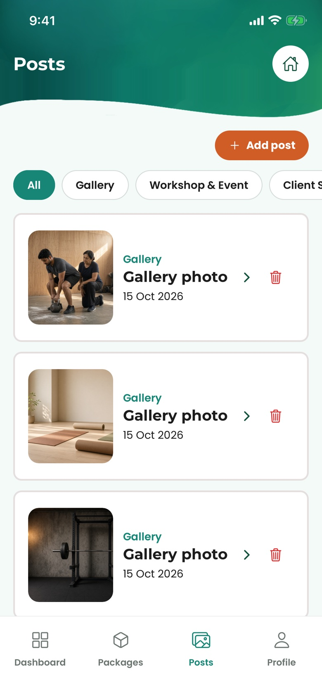
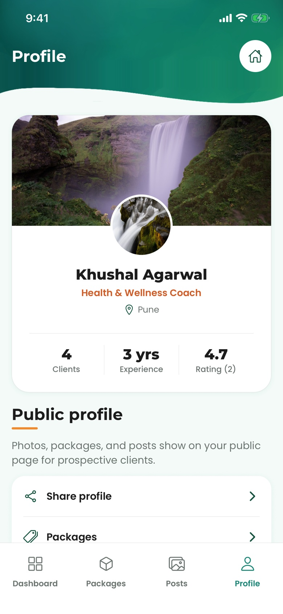
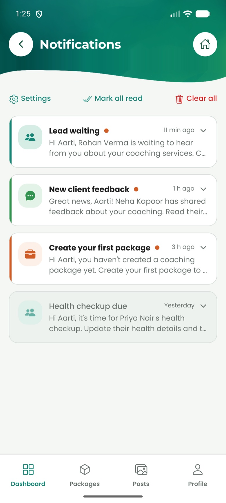
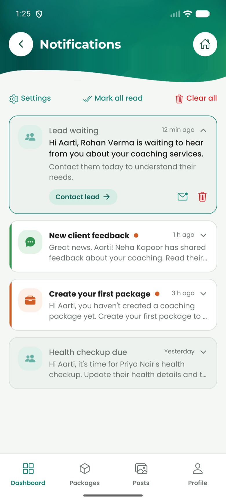
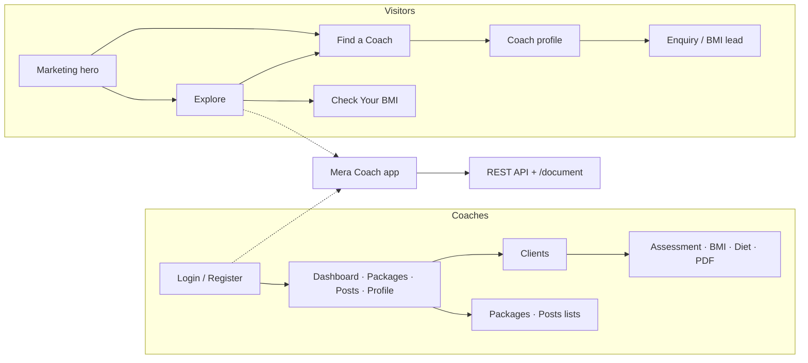

<div align="center">


# Mera Coach

**Get found by clients. Run the practice that follows.**

Visitors discover coaches and reach out.<br />
Coaches manage clients, deliver assessments, and keep the public listing that brings leads in.

[![CI][badge-ci]][actions-ci]
[![Release][badge-release-version]][releases]
![Android][badge-platforms]
[![Website][badge-website]][website]

<br />



<sub><b>Dashboard</b> — the practice at a glance</sub>

</div>

---

## One place for the coaching journey

|        | Journey            | What happens                                                                                             |
| ------ | ------------------ | -------------------------------------------------------------------------------------------------------- |
| **01** | **Discover**       | A marketing hero, then explore: banner, categories, features and Check Your BMI. No sign-in needed       |
| **02** | **Convert**        | Enquiry and BMI lead forms, and WhatsApp when the coach has shared a number                              |
| **03** | **Manage**         | Tabs: Dashboard, Packages, Posts, Profile. Clients, leads and due checkups sit under Dashboard           |
| **04** | **Deliver**        | Assessment wizard, then a BMI report and a multi-meal diet plan. Share them as PDFs and ask for feedback |
| **05** | **Build presence** | Packages and Posts each open a list; adding is its own screen                                            |

The mobile app for [mera-coach.com][website]. Android first, iOS later.

---

## Take a look

<div align="center">
<table>
  <tr>
    <td align="center" width="50%">
      
      <br />
      <sub><b>Home</b><br />The first screen: sign in or find a coach</sub>
    </td>
    <td align="center" width="50%">
      
      <br />
      <sub><b>Add client</b><br />The first step of the assessment</sub>
    </td>
  </tr>
  <tr>
    <td align="center" width="50%">
      
      <br />
      <sub><b>Client profile</b><br />Metrics, and everything you can do for this client</sub>
    </td>
    <td align="center" width="50%">
      
      <br />
      <sub><b>BMI report</b><br />An assessment made shareable as a PDF</sub>
    </td>
  </tr>
  <tr>
    <td align="center" width="50%">
      
      <br />
      <sub><b>Posts</b><br />Gallery, workshops and success stories for your public page</sub>
    </td>
    <td align="center" width="50%">
      
      <br />
      <sub><b>Profile</b><br />Your public page, ready to share</sub>
    </td>
  </tr>
  <tr>
    <td align="center" width="50%">
      
      <br />
      <sub><b>Notifications</b><br />A preview per alert, with unread ones highlighted</sub>
    </td>
    <td align="center" width="50%">
      
      <br />
      <sub><b>Tap to read</b><br />The full text and a button for the next step. Opening it marks it read</sub>
    </td>
  </tr>
</table>
</div>

<p align="center"><sub>iOS Simulator (Notifications: Android emulator) · light mode · the clients shown are sample data</sub></p>

---

## How it works

1. **Explore and find** — Open the app as a visitor. Home is a marketing hero, then explore: a banner, coach categories from the API, features, and Check Your BMI. Find a Coach filters by search, city and rating.
2. **Reach out** — Send an enquiry from a coach's public page, or a BMI lead from Check Your BMI. Open WhatsApp when a mobile number is available. Side arrows on a profile move between coaches in the browse list.
3. **Coach sign-in** — Register, or sign in with your login id and password, and land on the Dashboard.
4. **Run the practice** — The signed-in tabs are Dashboard, Packages, Posts and Profile. The Dashboard tracks clients, enquiry leads and due checkups. Add a client to start an assessment. The bell on the Dashboard opens the notification list.
5. **Assess and deliver** — Body stats, lifestyle, goals, BMI, then a multi-meal diet. Share the BMI report and diet plan as PDFs. Ask for feedback by SMS; the link opens the website.
6. **Shape the listing** — Packages and Posts open a list first. A package picks a product brand and products from the database; the coach sets each price and the total, and a switch shows or hides it on the public profile. A post picks a category (Gallery, Workshop & Event or Client Success), adds a photo or video, and is saved to the API. Client Success also needs a client and consent. Videos play inside the app.

---

## Features

| Area                      | What you get                                                                                                                                               |
| ------------------------- | ---------------------------------------------------------------------------------------------------------------------------------------------------------- |
| **Discovery**             | Public home · categories from the API · Check Your BMI · Find a Coach (city, rating, search) without signing in                                            |
| **Practice hub**          | Dashboard, Packages, Posts and Profile tabs · clients, leads, due checkups · tips video carousel                                                           |
| **Assessment & delivery** | Add-client wizard · BMI report with history · multi-meal diet plan · PDF download and share · feedback SMS                                                 |
| **Public presence**       | One coach photo and arrows through the browse list · packages, gallery, events and success stories · enquiry and BMI leads · WhatsApp                      |
| **Notifications**         | Push reminders for leads, check-ups, packages, events, gallery, feedback and plan expiry · a notification list with an unread badge: each alert shows a short preview, a tap expands it and marks it read, and a button opens the matching screen · four on/off switches |
| **Account**               | Register and sign in · password change · privacy and terms · in-app update prompt · support at `hello@mera-coach.com`                                      |

---

## Plans and the client limit

One switch, `EXPO_PUBLIC_SUBSCRIPTION_REQUIRED`, decides how the app treats subscriptions:

| Setting                             | What coaches see                                                                                                                            |
| ----------------------------------- | ------------------------------------------------------------------------------------------------------------------------------------------- |
| **Off** (`no`, `false`, `0`, unset) | No subscription, validity or payment screens. Every coach can add up to **10 clients**; at 10 the app explains the limit and offers support |
| **On** (`yes`, `true`, `1`)         | The paid flow: validity shown, Pay Now opens the website checkout, and unpaid coaches cannot add clients                                    |

The 10-client limit is checked in the app only; the API does not enforce it. Whether the app may send a coach to the website to pay is a separate switch, `EXPO_PUBLIC_EXTERNAL_PAYMENT_PLATFORMS` (see below). Store billing rules differ by platform, so check them before you turn payments on.

---

## Design

| Role      | Token        | Value     |
| --------- | ------------ | --------- |
| Primary   | `primary`    | `#d05c26` |
| Secondary | `secondary`  | `#178676` |
| Accent    | `accent`     | `#e8a317` |
| Surface   | `background` | `#f5f7f5` |

Primary is terracotta, secondary is teal and the surface is mint. The names and values are `Colors` in `src/constants/theme.ts`.

- **Type:** Montserrat headings, Poppins body text.
- **Chrome:** in-app screens use a wave header with back, title and home. Tab roots have a title and home but no back. The Dashboard has its own header.
- **Lists:** Find a Coach uses a circle page control, kept visible even on one page. Client, lead, checkup, event and package lists use a square page control.
- **System:** shared components (`AppButton`, `EmptyState`, `ReloadState`, `StickyFooter`, `WaveScreenHeader`), 44pt touch targets, empty, error and reload states, sticky footers for main actions and accessibility labels on interactive controls. Light UI only.

---

## Download

| Channel                         | What you get                                                                                               |
| ------------------------------- | ---------------------------------------------------------------------------------------------------------- |
| **[GitHub Releases][releases]** | An Android **APK**, attached after a tag `vX.Y.Z` and a successful [Release][workflow-release] run         |
| **Google Play**                 | Internal testing track today. Use `bun run ship:android` to send a build there (see Releasing)             |
| **iOS**                         | Not distributed yet (an Apple Developer account is needed). The simulator and Expo Go work for development |

A sideloaded APK does not get the in-app update prompt. Only installs from Google Play do.

---

## Tech

| Layer      | Choice                                                    |
| ---------- | --------------------------------------------------------- |
| App        | Expo 57 · React Native 0.86 · React 19 · TypeScript       |
| Navigation | React Navigation (native stack and bottom tabs)           |
| Data       | TanStack Query · typed API modules under `src/api/`       |
| Session    | `expo-secure-store`                                       |
| Media      | Image picker · document upload · PDF share · in-app video |
| Build      | EAS Build · Bun                                           |
| Quality    | ESLint · Prettier · Jest (`jest-expo`)                    |



<details>
<summary><b>Project layout</b></summary>

```
src/
  api/           HTTP client and one module per feature
  auth/          Session (SecureStore)
  components/    Shared UI
  config/        Environment-driven settings and flags
  navigation/    Root stack and tabs
  screens/       home, auth, dashboard, clients, checkups, profile, publicCoach, addClient
  utils/         Formatting, validation, sharing helpers
assets/brand/    Logo mark, wordmark, full lockup
.github/         CI and release workflows, PR template, README images
scripts/         release.sh, ship-android.sh
```

</details>

---

## Quick start

**Need:** Bun (or Node 20+), and Expo Go or an iOS / Android simulator. The Mera Coach API must be reachable from your phone or simulator.

```bash
git clone https://github.com/Khushal-ag/mera-coach-mobile.git
cd mera-coach-mobile
bun install
cp .env.example .env   # set EXPO_PUBLIC_API_BASE_URL
bun start              # then i / a / scan the Expo Go QR
```

| Variable                                 | Required | Purpose                                                                                                                       |
| ---------------------------------------- | -------- | ----------------------------------------------------------------------------------------------------------------------------- |
| `EXPO_PUBLIC_API_BASE_URL`               | Yes      | API origin. Photos, videos and PDFs come from the same host. Must not be localhost for store or GitHub builds                 |
| `EXPO_PUBLIC_WEB_BASE_URL`               | No       | Website used for feedback SMS links (default `https://mera-coach.com`)                                                        |
| `EXPO_PUBLIC_PAYMENT_URL`                | No       | Pay Now checkout (default `{WEB_BASE_URL}/premium`; the coach id is added)                                                    |
| `EXPO_PUBLIC_PRIVACY_POLICY_URL`         | No       | Hosted privacy policy for store listings (default `{WEB_BASE_URL}/privacy`)                                                   |
| `EXPO_PUBLIC_SUBSCRIPTION_REQUIRED`      | No       | The plans switch described above                                                                                              |
| `EXPO_PUBLIC_EXTERNAL_PAYMENT_PLATFORMS` | No       | Platforms that may open the website to pay: `ios`, `android`, `ios,android` or `none`. Blank means Android only               |
| `EXPO_PUBLIC_YOUTUBE_CHANNEL_ID`         | Yes*     | UC channel id (or `@handle`) for the dashboard tips carousel. Loaded directly from YouTube (RSS, then channel `/videos` HTML) |

Never commit real `.env` values. Everything prefixed `EXPO_PUBLIC_` is readable from the built app, so it must never hold a secret.

| Command                                           | Description           |
| ------------------------------------------------- | --------------------- |
| `bun start`                                       | Expo dev server       |
| `bun run ios` · `bun run android`                 | Native run            |
| `bun run typecheck` · `bun run lint` · `bun test` | The checks CI runs    |
| `bun run fmt` · `bun run fmt:check`               | Prettier              |
| `bun run doctor`                                  | `expo-doctor`         |
| `bun run ship:android` · `bun run release`        | Releasing (see below) |

### Native builds

The app id is `com.henchsolutions.meracoach` on iOS and Android. `ios/` and `android/` are generated and git-ignored; regenerate them with `npx expo prebuild --clean`.

```bash
LANG=en_US.UTF-8 LC_ALL=en_US.UTF-8 npx expo run:ios --device "<simulator name>"
```

- CocoaPods needs a UTF-8 locale, or `pod install` crashes.
- `ios/.xcode.env.local` should use `NODE_BINARY=/opt/homebrew/bin/node`, not a versioned Cellar path that breaks when node is upgraded.
- Expo SDK 57 apps do not use the UIScene lifecycle, so they crash on launch on an iOS 27 simulator. Use an iOS 26.x simulator until the project moves to Expo SDK 58.
- Picking a video for a post needs a native build that includes `expo-file-system`.
- **Ship this as a new version, for example `bun run ship:android 1.1.0`.** It is the first build with native push code. `runtimeVersion` follows the app version, so an `eas update` of this JavaScript on the old 1.0.9 runtime would crash every installed 1.0.9 app. Never publish an update of this code to a runtime built before it, and rebuild any dev client made before it, or the app will crash on launch.
- **Push notifications:** the app uses `expo-notifications`, so it needs a native build that includes it (rebuild the dev client). Alerts are sent by the API through Expo's push service. Push only works on a real phone, never in a simulator.
  - **Android needs Firebase.** Create a Firebase project for `com.henchsolutions.meracoach`, put its `google-services.json` in the project root (git-ignored) and set `android.googleServicesFile` in `app.json`; for EAS builds keep the file as an EAS file secret instead. Upload the project's FCM service-account key to EAS (`eas credentials`). Without this the app still runs, the notification list works, but no push arrives.
  - **How it works:** after sign-in the app asks once (with a short explanation) for permission, then registers its Expo push token with `POST /Notification/device`. Sign-out removes it. Tapping an alert opens the matching screen (`src/notifications/notificationTarget.ts`).
  - **Testing one:** run the API with the scheduler on, sign in on a real phone, then add a lead for that coach and wait for the next 15-minute run (reminders only go out 9am to 8pm IST), or submit feedback through the web form for an instant alert.
- **Opening the app from a link:** `app.json` declares an Android App Link for `https://www.mera-coach.com/coach-login`, so the welcome email's "Login to Mera Coach" button opens the app when it is installed. It works once the website serves `/.well-known/assetlinks.json` with the Play app-signing fingerprint and the app has been released with this change. iOS would need Universal Links, which need an Apple Developer account.

---

## Releasing

The app version lives in three places and they must match for every public release:

| Location       | Field          | Example  |
| -------------- | -------------- | -------- |
| `package.json` | `version`      | `1.1.0`  |
| `app.json`     | `expo.version` | `1.1.0`  |
| Git tag        | `vX.Y.Z`       | `v1.1.0` |

Use semver: **major** for breaking changes to what coaches rely on, **minor** for new features, **patch** for fixes and polish. Android `versionCode` is raised by EAS on every cloud build (`autoIncrement` with a remote app version source).

### To Google Play (internal testing)

```bash
bun run ship:android            # build and send the current version
bun run ship:android 1.1.1      # bump package.json and app.json to 1.1.1 first
```

This runs `eas build --platform android --profile production --auto-submit`. EAS builds the bundle and uploads it to the track set in `eas.json`, which is fixed to `internal`, so this command cannot reach production by accident. Commit the version bump afterwards. To promote a tested build, use **Promote release** in Play Console.

<details>
<summary><b>One-time setup: let EAS upload to Play</b></summary>

1. Google Cloud Console: create or pick a project and enable the **Google Play Android Developer API**.
2. IAM & Admin, Service accounts: create a service account, then add a JSON key and download it.
3. Play Console, **Users and permissions**: invite the service account email with **Release to testing tracks** for Mera Coach. Play can take up to a day to activate it.
4. Upload the key to EAS once so it never lives in the repo: `bunx eas-cli credentials`, then Android, production, **Google Service Account**, **Manage your Google Service Account Key for Play Store Submissions**. Delete the local copy afterwards.

If the first run says the service account has no access, wait and retry. The very first upload of a new app cannot be automated; this app already has one.

</details>

### GitHub Release APK

Production path: **tag `vX.Y.Z` → CI checks → EAS Android APK → GitHub Release**.

```bash
bun run release                          # versions match on a clean, pushed main: tags and pushes
./scripts/release.sh --bump X.Y.Z        # bump, commit, push main and tag
```

The script checks that `package.json` and `app.json` agree, creates the annotated tag and pushes it, which starts the [Release][workflow-release] workflow: it re-runs typecheck, lint and tests, builds the APK with the `production-apk` profile and attaches it to the Release. Running the workflow by hand needs a tag that already exists; it never creates tags.

| Needed                 | Where                             | Purpose                                                       |
| ---------------------- | --------------------------------- | ------------------------------------------------------------- |
| `EXPO_TOKEN` secret    | GitHub Actions                    | Lets CI run EAS builds. Create it at expo.dev → Access tokens |
| `EXPO_PUBLIC_*` values | The Expo project's production env | Build-time settings. Keep them out of the repo                |
| Android keystore       | EAS credentials                   | Signs the app                                                 |

| EAS profile      | Purpose                                                        |
| ---------------- | -------------------------------------------------------------- |
| `development`    | Dev client, internal                                           |
| `preview`        | Internal channel, Android APK                                  |
| `production`     | Store builds (Android AAB)                                     |
| `production-apk` | `production` with an Android APK, for GitHub Release downloads |

Store submit by hand after an EAS build: `eas submit --platform android --profile production`. It needs a Play listing (privacy URL, screenshots, content rating). iOS submit waits for an Apple Developer account.

### In-app update prompt

Profile shows an "Update available" card, and a dot on the Profile tab, when the store has a newer version. It uses `expo-in-app-updates`:

- **Android:** Google Play's own update overlay. It only answers for installs that came from Google Play, so it never appears on sideloaded APKs, on emulators without Google Play, or for a version code that is already installed.
- **iOS:** looks the app up in the App Store. Set `ios.infoPlist.AppStoreID` in `app.json` once the listing exists.
- Publishing a new version to the store is all it needs. Nothing to configure in the API.
- The card also shows "Update ready, Restart now" when an over-the-air JavaScript update has been downloaded (`expo-updates`, production channel).

`expo-in-app-updates` is a native module, so the first build that contains it must be a new store build with a bumped version. Because `runtimeVersion` follows the app version, never publish an OTA update from new code to installs of an older version. The app loads the module defensively, so an older build without it keeps working and just never shows the card.

To test: install a build that has it from the Play link, upload a newer build to the same track, then open Profile. Play can take minutes to hours to tell the phone; opening the Play Store app and pulling to refresh can speed it up.

---

## Contributing

1. Keep changes focused. Avoid unrelated refactors.
2. Run `bun run typecheck`, `bun run lint` and `bun test` before opening a pull request, and fill in the PR template.
3. Do not commit `.env`, keystores or real credentials.

---

## License

MIT — see [`LICENSE`][doc-license].

---

<div align="center">


<sub>Built for coaches on [mera-coach.com][website]</sub>

</div>

<!-- Links -->

[website]: https://mera-coach.com
[badge-ci]: https://github.com/Khushal-ag/mera-coach-mobile/actions/workflows/ci.yml/badge.svg
[badge-release-version]: https://img.shields.io/github/v/release/Khushal-ag/mera-coach-mobile?include_prereleases&label=release
[badge-platforms]: https://img.shields.io/badge/Android-lightgrey
[badge-website]: https://img.shields.io/badge/Website-mera--coach.com-c04b2b
[releases]: https://github.com/Khushal-ag/mera-coach-mobile/releases
[actions-ci]: https://github.com/Khushal-ag/mera-coach-mobile/actions/workflows/ci.yml
[workflow-release]: .github/workflows/release.yml
[doc-license]: LICENSE
