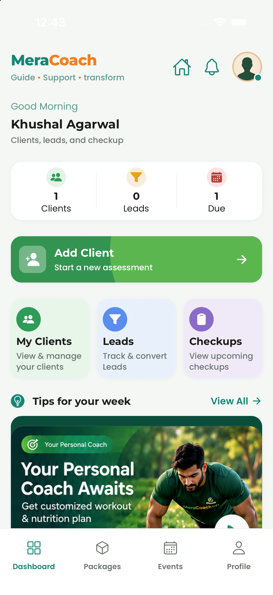
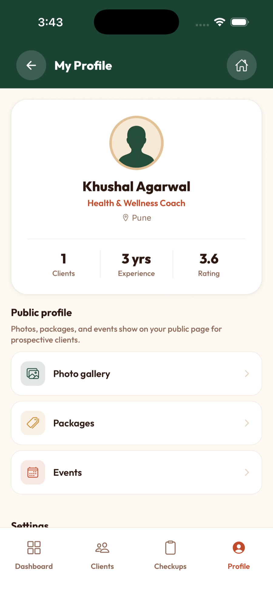
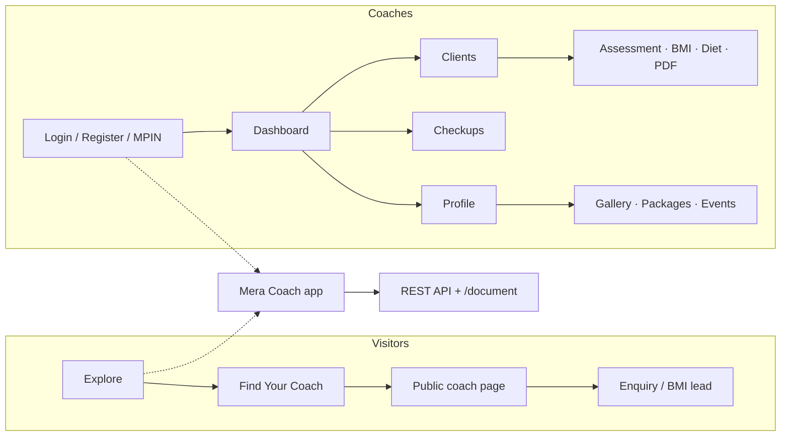

<div align="center">


# Mera Coach

**Get found by clients. Run the practice that follows.**

Visitors discover coaches and reach out.<br />
Coaches manage clients, deliver assessments, and keep the public listing that brings leads in.

[![Latest Release][badge-latest-release]][release-latest]
&nbsp;
[![Website][badge-website]][website]
&nbsp;
[![Releases][badge-releases]][releases]

[![CI][badge-ci]][actions-ci]
[![Release][badge-release-version]][releases]
![iOS and Android][badge-platforms]

<br />



<sub><b>Dashboard</b> — the practice at a glance</sub>

</div>

---

## One place for the coaching journey

|        | Journey            | What happens                                                                       |
| ------ | ------------------ | ---------------------------------------------------------------------------------- |
| **01** | **Discover**       | Browse categories, Find Your Coach (search, city, rating) — no sign-in required    |
| **02** | **Convert**        | Enquiry & BMI lead forms; WhatsApp when the coach has shared a number              |
| **03** | **Manage**         | Dashboard for clients, leads, and due checkups; client detail with goals & actions |
| **04** | **Deliver**        | Assessment wizard → BMI report & multi-meal diet · PDF share · feedback SMS        |
| **05** | **Build presence** | My Profile hub — gallery, packages, and events for the public listing              |

Mobile app for [mera-coach.com][website] · Expo · iOS & Android · API via `EXPO_PUBLIC_API_BASE_URL` (photos & PDFs on the same host)

---

## Product showcase

### Discover

<table>
  <tr>
    <td align="center" width="50%">
      
      <br />
      <sub><b>Explore</b><br />Where visitors land — categories, BMI check, Find a Coach</sub>
    </td>
    <td align="center" width="50%">
      
      <br />
      <sub><b>Find Your Coach</b><br />Search and filters that surface the right coach</sub>
    </td>
  </tr>
</table>

### Manage

<div align="center">
  
  <br />
  <sub><b>Client detail</b><br />One client — metrics, goals, next actions</sub>
</div>

### Deliver

<div align="center">
  
  <br />
  <sub><b>BMI report</b><br />Assessment made shareable — composition, history, PDF</sub>
</div>

### Build presence

<div align="center">
  
  <br />
  <sub><b>My Profile</b><br />Shape the public page — gallery, packages, events</sub>
</div>

<p align="center"><sub>iOS Simulator · light mode</sub></p>

---

## How it works

1. **Explore & find** — Open the app as a visitor. Browse coaching categories or use Find Your Coach (search, city, rating).
2. **Reach out** — Send an enquiry or BMI lead from a coach’s public page, or open WhatsApp when a mobile number is available.
3. **Coach sign-in** — Register or log in. On return, unlock with MPIN. Land on Dashboard.
4. **Run the practice** — Track clients, enquiry leads, and due checkups. Add a client to start an assessment.
5. **Assess & deliver** — Body stats → lifestyle → goals → BMI → multi-meal diet. Share BMI and diet PDFs. Ask for feedback via SMS (links to the site).
6. **Shape the listing** — Edit gallery, packages, and events from My Profile so the public page stays current.

---

## Features

| Area                      | What you get                                                                                             |
| ------------------------- | -------------------------------------------------------------------------------------------------------- |
| **Discovery**             | Explore by category · Find Your Coach (city, rating, search) · public browse without signing in          |
| **Practice hub**          | Dashboard metrics · clients list & detail · leads · checkups due                                         |
| **Assessment & delivery** | Add-client wizard · BMI report with history · multi-meal diet plan · PDF download & share · feedback SMS |
| **Public presence**       | Profile gallery, packages, events · enquiry & BMI leads · WhatsApp when available                        |
| **Account**               | Coach register / login · MPIN · password change · privacy & terms · support via `hello@mera-coach.com`   |

---

## Why Mera Coach

- **Discovery and delivery share one product** — visitors browse; coaches work the same app after sign-in.
- **Assessment that finishes the job** — body stats through BMI and diet, with PDFs coaches can share.
- **A listing that brings work in** — gallery, packages, and events feed the public page; enquiries and WhatsApp close the loop.
- **Thoughtful mobile UX** — Outfit + Fraunces, forest / terracotta / gold, shared empty / error / reload states

---

## Design

| Role      | Token      | Value     |
| --------- | ---------- | --------- |
| Primary   | Terracotta | `#c04b2b` |
| Secondary | Forest     | `#1b4332` |
| Accent    | Gold       | `#c9882a` |
| Surface   | Cream      | `#fdf8f2` |

**Type** — Outfit (UI) · Fraunces (display)

**System** — Shared components (`AppButton`, `EmptyState`, `ReloadState`, `StickyFooter`, `ScreenHeader`) · 44pt touch targets · empty / error / reload states · sticky footers for primary CTAs · accessibility labels on interactive controls

**Tokens** — `src/constants/theme.ts` · light UI only (`userInterfaceStyle: light`)

---

## Download Mera Coach

| Channel                         | What you get                                                                                                        |
| ------------------------------- | ------------------------------------------------------------------------------------------------------------------- |
| **[GitHub Releases][releases]** | Android **APK** is published there after a tag `vX.Y.Z` and a successful [Release][workflow-release] run — none yet |
| **iOS**                         | Built with EAS `production` for App Store / TestFlight — IPA is **not** attached for sideloading                    |
| Google Play / App Store         | Not linked here yet — use `eas submit` when listings are ready                                                      |

Prefer Releases assets or official store listings once published. No fabricated store URLs.

<div align="center">

[![Android APK via Releases][badge-apk]][releases]

</div>

---

## Tech

| Layer      | Choice                                                      |
| ---------- | ----------------------------------------------------------- |
| App        | Expo 57 · React Native 0.86 · React 19 · TypeScript         |
| Navigation | React Navigation (native stack + bottom tabs)               |
| Data       | TanStack Query · typed API modules under `src/api/`         |
| Session    | `expo-secure-store`                                         |
| Media      | Image picker · document upload · PDF share (`expo-sharing`) |
| Build      | EAS Build · Bun                                             |
| Quality    | ESLint · Prettier · Jest (`jest-expo`)                      |

### Architecture



<details>
<summary><b>Project layout</b></summary>

```
src/
  api/           HTTP client & domain APIs
  auth/          Session (SecureStore)
  components/    Shared UI
  navigation/    Root stack + main tabs
  screens/       home, auth, dashboard, clients, checkups, profile, publicCoach, addClient
assets/brand/    Logo mark, wordmark, full lockup
docs/            RELEASING.md · screenshots/
```

</details>

---

## Quick start

**Need:** Bun (or Node 20+) · Expo Go or iOS / Android simulator

```bash
git clone https://github.com/Khushal-ag/mera-coach-mobile.git
cd mera-coach-mobile
bun install
cp .env.example .env   # set EXPO_PUBLIC_API_BASE_URL
bun start              # then i / a / Expo Go QR
```

| Variable                         | Required | Purpose                                              |
| -------------------------------- | -------- | ---------------------------------------------------- |
| `EXPO_PUBLIC_API_BASE_URL`       | Yes      | REST + `/document` media                             |
| `EXPO_PUBLIC_WEB_BASE_URL`       | No       | Feedback SMS site (default `https://mera-coach.com`) |
| `EXPO_PUBLIC_PRIVACY_POLICY_URL` | No       | Store listing privacy URL                            |

Never commit real `.env` values. Support: `hello@mera-coach.com`

<details>
<summary><b>Scripts</b></summary>

| Command                                           | Description     |
| ------------------------------------------------- | --------------- |
| `bun start`                                       | Expo dev server |
| `bun run ios` / `bun run android`                 | Native run      |
| `bun run typecheck` · `bun run lint` · `bun test` | CI checks       |
| `bun run fmt`                                     | Prettier        |
| `bun run doctor`                                  | `expo-doctor`   |

</details>

---

## Releases

Production path: **tag `vX.Y.Z` → CI checks → EAS build → GitHub Release**.

- Version rule: `package.json` = `app.json` `expo.version` = tag `vX.Y.Z`
- Android: `production-apk` → APK on the GitHub Release
- iOS: `production` → App Store / TestFlight path (no sideload IPA asset)
- Full guide: [`docs/RELEASING.md`][doc-releasing]

<details>
<summary><b>EAS builds (local)</b></summary>

```bash
eas login
eas build --profile preview --platform android        # internal APK
eas build --profile production --platform all         # store AAB + iOS
eas build --profile production-apk --platform android # GitHub APK
```

</details>

---

## Contributing

See [`CONTRIBUTING.md`][doc-contributing]. Keep PRs focused; run typecheck, lint, and tests before opening.

---

## License

MIT — see [`LICENSE`][doc-license].

---

<div align="center">


<sub>Built for coaches on [mera-coach.com][website]</sub>

</div>

<!-- Link & asset references -->

<!-- Brand / logos (hero/footer use HTML ; refs kept for reuse) -->

[logo-full]: assets/brand/logo-full.png
[logo-mark]: assets/brand/logo-mark.png

<!-- Screenshots (paths; showcase uses HTML  for sizing on GitHub) -->

[shot-explore]: docs/screenshots/explore.png
[shot-find-coach]: docs/screenshots/find-coach.png
[shot-dashboard]: docs/screenshots/dashboard.png
[shot-client-detail]: docs/screenshots/client-detail.png
[shot-bmi-report]: docs/screenshots/bmi-report.png
[shot-profile]: docs/screenshots/profile.png

<!-- Product / web -->

[website]: https://mera-coach.com

<!-- Badges -->

[badge-latest-release]: https://img.shields.io/badge/Latest_Release-Download-1b4332?style=for-the-badge
[badge-website]: https://img.shields.io/badge/Website-mera--coach.com-c04b2b?style=for-the-badge
[badge-releases]: https://img.shields.io/badge/Releases-All_builds-c9882a?style=for-the-badge
[badge-ci]: https://github.com/Khushal-ag/mera-coach-mobile/actions/workflows/ci.yml/badge.svg
[badge-release-version]: https://img.shields.io/github/v/release/Khushal-ag/mera-coach-mobile?include_prereleases&label=release
[badge-platforms]: https://img.shields.io/badge/iOS_%7C_Android-lightgrey
[badge-apk]: https://img.shields.io/badge/Android_APK-via_GitHub_Releases-1b4332?style=for-the-badge

<!-- GitHub (repo, releases, issues, actions) -->

[release-latest]: https://github.com/Khushal-ag/mera-coach-mobile/releases/latest
[releases]: https://github.com/Khushal-ag/mera-coach-mobile/releases
[actions-ci]: https://github.com/Khushal-ag/mera-coach-mobile/actions/workflows/ci.yml

<!-- Docs -->

[workflow-release]: .github/workflows/release.yml
[doc-releasing]: docs/RELEASING.md
[doc-contributing]: CONTRIBUTING.md
[doc-license]: LICENSE
